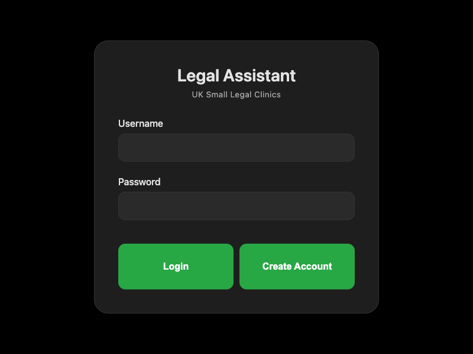
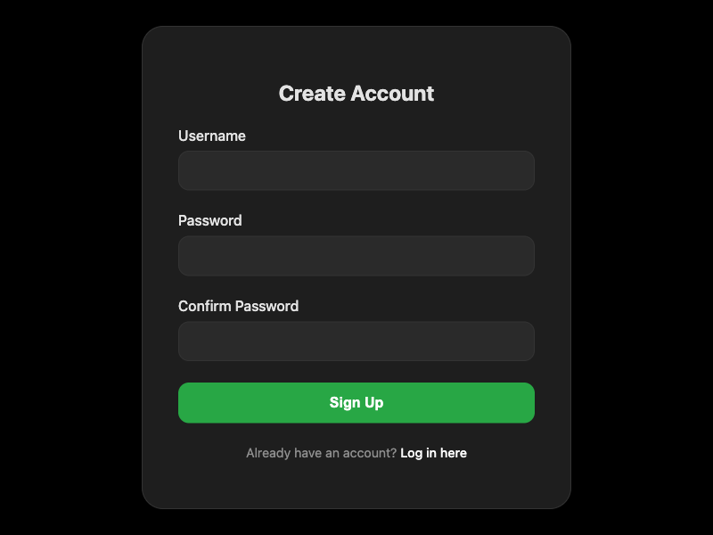
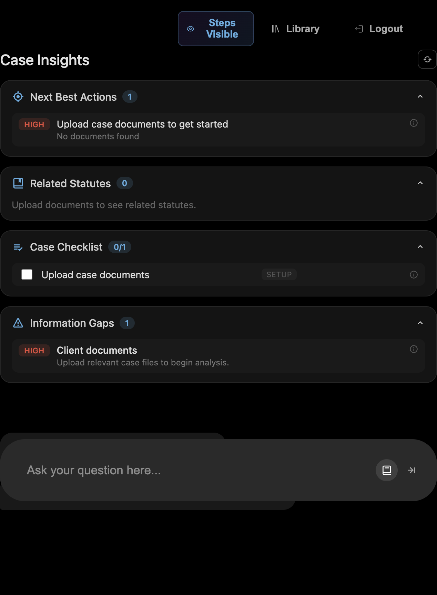
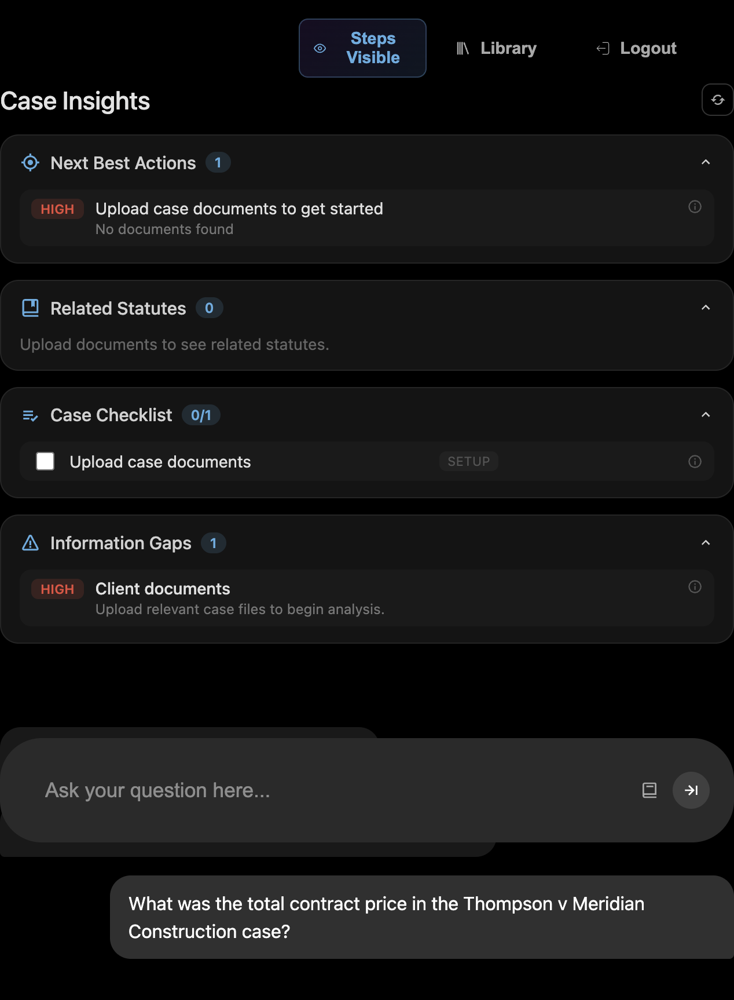
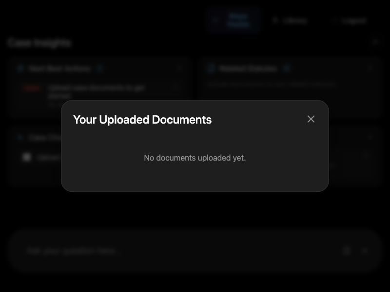

# Feature Walkthrough

This walkthrough documents the main local user flow of the web app. The screenshots focus on authentication, upload, document-specific question answering, and the main workspace view.

## Login Screen

The login screen is the entry point to the app and acts as the session gate before any case material becomes visible. It contains a username field, a password field, and two primary actions: logging in or creating a new account. This screen is intentionally minimal because its job is to authenticate the user and route them into the protected workspace. The visible components are the centered login card, the product title, the subtitle for the target use case, the input form, and the two large call-to-action buttons.

## Account Creation Screen

The account creation screen is the sign-up flow for new users who do not already have an account. It provides fields for username, password, and password confirmation, plus a sign-up button and a link back to the login page. This screen shows the same restricted-access design as the login page, but with extra validation for matching passwords before submission. The visible components are the form title, three stacked input fields, the sign-up button, and the navigation link that returns the user to the login screen.

## Main Workspace

The main workspace is the primary working area of the application after authentication. It combines the proactive case insights panel at the top with the question input area at the bottom, so the user can review document-derived signals and ask new questions in the same view. In the updated capture, the workspace also shows a document-specific answer thread with inline citations pulled from the uploaded case files. The top controls include the Steps Visible toggle, the Library button, and the Logout action, while the Case Insights cards show next actions, related statutes, checklist items, and information gaps. The visible components here are the insight cards, the top navigation buttons, the query input bar, and the answer thread with citations.

## Uploading Documents

This screenshot shows the upload and ingestion state after five case PDFs were selected. The interface displays a clear progress message so the user knows the files are being processed and added to the local knowledge base. This is the stage where the backend validates the files, ingests them, and prepares them for retrieval in later questions. The visible components are the upload status message, the disabled question input while processing completes, and the standard workspace controls above the content area.

## Question and Answer

This screenshot shows a document-specific question and the generated answer based on the uploaded case files. The response includes an inline citation pointing to the source document and page, and the agent step panel shows the planner, retriever, and responder sequence used to produce the answer. This is the clearest evidence that the app is grounding its responses in the uploaded material rather than replying from general knowledge alone. The visible components are the user question, the answer text, the citation, and the agent steps for planning, retrieval, and response generation.

## Document Library Modal

The document library modal is the document-management screen for the logged-in user. It is used to review the files currently uploaded for that account and, when documents exist, remove them from the knowledge base. In the captured state the modal shows the empty-state message, which is useful because it makes the upload dependency obvious: the app cannot surface retrieved answers until the user has added documents. The visible components are the modal overlay, the title, the close icon, and the empty-state message inside the document list area.
